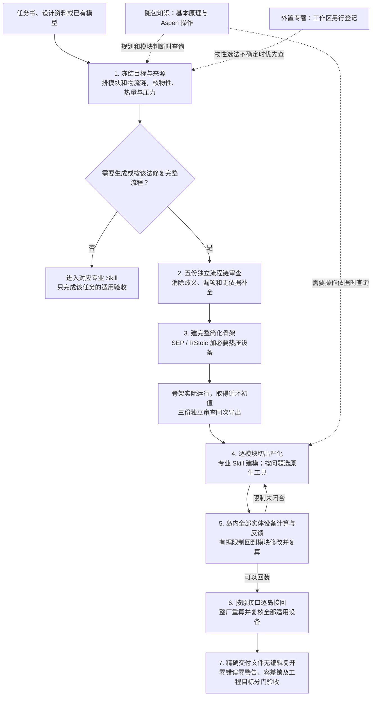

# 化工设计专家工作库

面向化工设计与 Aspen Plus 自动化任务的工作流和工具集合，包含 **19 个 Skill**、本地知识检索、设备计算程序，以及命令行和可选 MCP 接口。支持从设计资料或已有模型出发，组织流程构建、计算、修改、复核和成果交付。

使用时可以提供任务书、设计基准、参数表、运行记录或现有 Aspen 文件。系统按当前问题选择相关模块，提取输入、查询适用方法、调用工具，并记录计算结果、依据与未完成项。

[下载发行包](https://github.com/milklong888/chemical-engineering-skills/releases) · [使用手册](docs/使用手册.md) · [工作流与功能说明](docs/工作流与功能说明_0.4.10.md) · [19 个模块说明](docs/模块说明.md)

## 0.4.10 更新：全流程生成与严格交付

本版把“先补全并核对流程链、再运行简化骨架、逐模块严化和设备反馈、最后接回全流程”落实为可检查的阶段。岛内全部实体设备在回装前完成同版选型反馈；交付继续要求精确文件复开后的零错误零警告，并禁止通过更改默认或已有求解容差取得表面收敛。实际调用顺序、功能分工与尚需真实工程验证的边界见[工作流与功能说明](docs/工作流与功能说明_0.4.10.md)。

## 0.4.9 修复：分库查询范围

指定知识分库时，查询词的统计也限定到该分库的可用内容，避免其他分库的零碎片段干扰召回。原来的知识正文、来源、关系和哈希向量不变；四批 69 个新增知识块继续完整提供。修复范围、复现与限制见[0.4.9 查询修复](docs/知识查询修复_0.4.9.md)。

## 0.4.8 更新：知识内容与查询

四批新增资料已按实际用途筛选，共保留 69 个完整知识块，覆盖反应过程、精馏动态控制、热力学与相平衡、换热网络和蒸汽动力系统。知识库现有 6942 条记录，6919 条进入随包哈希向量索引；完整释义、关联和来源记录都在仓库及发行包内，原始 PDF 不公开。

查询增加自然中文片段匹配，让直接相关内容不再被弱相关的高层原则挤下去；完全同文结果合并展示，同时保留各自 ID 和来源。另补齐贡献与读取准则，重复及无实际用途的内容不凑条目。实际处理范围、测试和限制见[0.4.8 知识库更新](docs/知识库更新_0.4.8.md)及[知识贡献准则](knowledge/CONTRIBUTING.md)。

## 0.4.7 修复：检查执行与交付完整性

Skill 是供助手读取的工作指南，连接相应资料和工具。此前的任务检查发现：助手有时只解释应该检查什么，没有实际查询；完成局部工作后遗漏接手和最终合并责任；选择求解方式时，也可能把目标匹配误当优化。

本版针对这些遗漏修改了入口和工具。阶段检查集中返回实际执行状态，专业证据审查连接到真实查询；优化路由必须有目标定义及方向。流程安排增加边界与交接结构检查，协作任务由主助手接纳并最终合并。资料没有说明的百分数基准和压力定义留作待核项，交付复核同时检查动作、结论及其依据。

经验提醒明确区分内容确认与公开授权，补齐具体摘要、适用范围和可点击投稿入口，配套脚本和文件处理的收尾也有相应入口。已有授权的草稿准备要求交付实际内容；批次整理需读取现行定义、实际检查可用正反例，并交付具体修改或不改动的依据与回退方案。

费用框架提供无数据时的明确草案入口，并在计算前核对设备覆盖、实际价格来源和成套采购范围；未解决的重复计费、来源错配和费用分类冲突保留为阻断项。仅有文字设备清单时，也可先整理物理候选和待核采购范围。问题、具体改法和使用变化见[0.4.7 修复说明](docs/Agent任务执行与经验整理修复_0.4.7.md)；原有任务组织与研究采用说明见[Agent 工作流更新](docs/Agent工作流更新_2026-09-12.md)。

## 工作流

拿到资料后，先把反应、分离、循环、产品和废物流连成可解释的模块链，同时核对物性方法、压力损失和热量来源。完整流程先由五份独立审查找歧义与漏项，再用有依据的 SEP/RStoic 简化骨架实际运行，取得循环初值，并由三份独立审查对照同次导出。已有模型从它当前有效的阶段继续，不为走形式而重建。

随后把一个功能模块按原接口切出，用相应专业方法严化。需要联动控制、目标匹配或优化时，先分清问题，再用适用的 Aspen 原生 Calculator、Design Spec/Vary、Sensitivity 或 Optimization；脚本负责建卡、运行和取证，不以外部逐点试算冒充原生求解。该岛的全部实体设备以最新导出计算，真实能力限制返回模块修改并复算，缺目录型号则保留证据缺口，不机械加设备。

合格模块逐个接回后，整厂重新核对物流、循环、热量、压力、产品和全部适用设备。正式交付使用精确文件无编辑复开运行的证据：完整版本表头中所有错误和警告计数为零，同次 Control Panel 消息和原始历史均无实际问题行；默认及已有求解容差的数值和默认／显式状态与基线一致。局部收敛、文件保存或选型回执都不能替代这一步。

## 各部分能做什么

专家层负责判断流程有没有物理和工程上的明显矛盾，锁定用户指定方法与设计基准；文档建模、塔、反应、热泵、压力和修复等 Skill 分别完成相应模块。现有 19 项的输入、产物与交接见[模块说明](docs/模块说明.md)。

随包的分层知识帮助查原理、方法和 Aspen 操作，外置专著则只在需要时从当前工作区另查，特别用于物性方法适用性判断；两者不会替当前项目给参数。设备后台先算可闭合参数，再判断单机能力、目录覆盖和证据缺口，并把换热、泵、压缩机和塔等设备的限制反馈给工艺层。命令行可直接调用这些能力，MCP 是可选接口，不是建模或验收的必要条件。

费用、动力学说明、工程文件与设备交接也有独立入口，窄任务只调用所需模块。每个阶段分别留下执行、计算和未闭合项；只有用户确认当前任务结束，才审查能否把经验作为新规则或数据规律复用。完整说明见[工作流与功能说明](docs/工作流与功能说明_0.4.10.md)，计算与软件环境边界见[外部依赖](docs/外部依赖.md)。

## 计算工具与知识调用

建模时应找哪个模块、设计规定和计算器在何时加入，以及原有脚本如何接到工作流，
见[建模入口与工作步骤](docs/modeling_start_here.md)。正式塔建模/优化保留有效
Design Spec/Vary；每个外层工况重新解产品目标。Calculator 的构建时机和每轮执行
顺序分别核对，不能与设计规定重复控制同一输入。

求解路由按问题区分读值、运行时联动、目标匹配、响应分析和多变量优化，帮助选择 Calculator、Design Spec/Vary、Sensitivity 或 Optimization 等适用方式。比较前明确哪些条件固定、哪些操作量需要联动。

设计阶段接口可调用本地知识检索和已有设备程序，返回查询、计算与输入缺口记录。知识条目按适用条件使用，项目数值取自当前资料或明确的计算推导。设备检查产生的修改建议，由相关流程模块实施并复算。

知识增补按资料逐份处理，先检查实际用途和已有覆盖：重复知识、无用内容跳过，只保留有用的增量。内容以完整知识块组织，读者能无歧义地复述其含义和必要条件即可，不追求零碎条目数量；查询先找足以回答问题的层次，需要时再下钻。具体见[知识入库与读取规则](plugins/chemical-engineering-skills/skills/chemical-engineering-expert/references/COMMON_SENSE_RAG.md)。

本次新增主题与实际处理范围见 [knowledge/intake/README.md](knowledge/intake/README.md)。

路由结果用于安排下一步工作；实际软件操作和验收另行执行。原生 Sensitivity 的目标接口资格核验仍待完成。接口、调用时机和范围见[内置工具使用说明](plugins/chemical-engineering-skills/skills/aspen-document-driven-flowsheet/references/aspen_builtin_solve_fit_tools.md)与[设计阶段调用](plugins/chemical-engineering-skills/skills/chemical-engineering-expert/references/DESIGN_STAGE_ROUTING.md)。

## 0.4.6 更新：Agent 工作流与经验管理

0.4.6 汇集了任务组织、按需读取、决策树、文件影响与运行记录索引、经验收件和主动提醒的更新。现有 19 项 Skill 的输入、产物和协作关系已整理，配套工具可用于检查改动影响、文件身份和经验候选。收件校验与 GitHub 检查观察工具由独立的[公开经验收件库](https://github.com/milklong888/chemical-engineering-experience-inbox)提供。

经验维护区分临时收件和正式采用。正式整理沿用已有的资格与候选审核流程，保留规则版本、维护位置和回退记录；阶段提醒要求助手给出具体摘要、适用条件和投稿入口。

本次采用了哪些研究思路、实际改了什么，以及现在可以怎样使用，见[Agent 工作流统一更新说明](docs/Agent工作流更新_2026-09-12.md)。

### 经验提醒与投稿

从 0.4.6 起，19 个 Skill 的阶段收尾规则要求主助手检查是否形成了值得复用的新经验，并展示具体摘要、适用条件和投稿入口。已执行的方法核对实际版本与验证范围；思想原则先由使用者确认具体内容，再由助手审核。

使用者可以授权公开脱敏候选，按[中文投稿指南](https://github.com/milklong888/chemical-engineering-experience-inbox/blob/main/docs/USER_SUBMISSION_GUIDE.zh-CN.md)提交 PR。有效授权在其范围内沿用，拒绝或撤回后停止相应提醒和提交。临时收件与正式知识更新分别审核，详细流程见[经验提醒与收件规则](plugins/chemical-engineering-skills/skills/chemical-engineering-expert/references/EXPERIENCE_INBOX.md)。

提醒由助手执行，仍需检查具体操作是否完成。安装 Skill 不会自动采集或上传项目；其他电脑需要自行更新并重新安装。

## 安装条件与验证范围

完整离线包的依赖面向 **Windows AMD64、CPython 3.14**。按[使用手册](docs/使用手册.md)校验并安装，将项目资料与结果放在独立工作区。本地知识查询和常规设备计算可通过命令行执行，MCP 是可选接口；AI 对话是否联网取决于所用模型服务。

真实 Aspen Plus、EDR、SW6 操作需要目标电脑具备相应软件、许可和适配环境。当前项目的模型、设计条件、厂家资料和报价由使用者提供。

验证记录分别覆盖文件完整性、程序行为、工具调用和助手任务表现。软件检查通过不直接代表工程方案通过；具体项目仍需基于目标版本与实际交付文件验收。更新内容见[发行说明](https://github.com/milklong888/chemical-engineering-skills/releases/latest)，验证方法见[验证说明](docs/验证说明.md)。

## 文档导航

- [使用手册](docs/使用手册.md)：安装、环境配置与操作示例。
- [模块说明](docs/模块说明.md)：19 个 Skill 的职责、输入和交接。
- [文件索引](docs/文件索引.md)：脚本、知识数据和模块文件。
- [后台运行与计算说明](docs/后台运行与计算说明.md)：参数计算与设备反馈。
- [Agent 工作流统一更新说明](docs/Agent工作流更新_2026-09-12.md)：任务组织、维护工具、经验复用与投稿。
- [决策树](plugins/chemical-engineering-skills/skills/chemical-engineering-expert/references/TASK_DECISION_TREES.md)：任务选择、排错和证据判断分支。
- [组织与影响索引](docs/skill_organization.md)、[观察索引](docs/observation_index.md)：维护时的引用检查和运行记录核对。
- [源码与数据边界](docs/源码与数据边界.md)、[来源与许可](docs/来源与许可.md)：组成、来源记录和使用条件。
