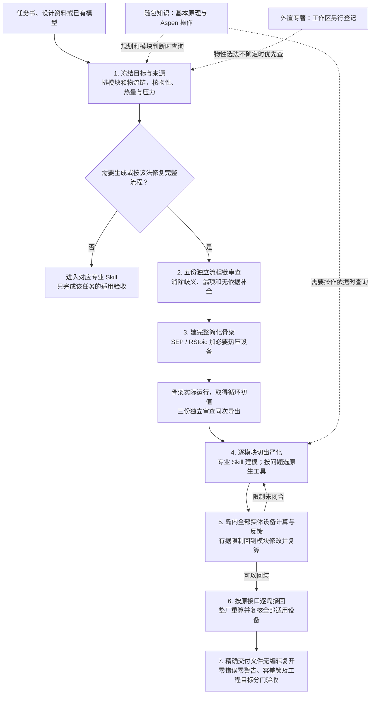

# 0.4.10 工作流与功能说明

这套工作库用于从设计资料或已有 Aspen 模型出发，建立、修改和检查化工流程。它把工艺判断、软件操作、知识检索和设备计算接在一条可追溯的工作线上；窄任务只走实际需要的部分。

## 工作流

### 1—2：先把要求说清楚，再审流程链

先从原文和当前模型提取进料、产品、反应与分离目标、温压条件、循环和终端去向。每个模块要说明入口、出口、物料组成及热力学方法；升压、预热、冷却和压降也在连接处判断，不能靠直接改物流温压掩盖设备。能从资料、单位换算或衡算得到的量先算；仍不确定的条件写出最小缺口和有据候选。内置图谱用于常见原理与 Aspen 操作，物性选法存在疑问时先查工作区已登记的外置专著，再核软件方法名称和参数适用性。检索结果不提供当前项目的默认数值。

完整流程在同一冻结版本上接受五份独立的模块—物性—出入物料—连接审查。主助手逐项处理歧义和漏项，也检查是否把经验提案误写成原文要求。单塔、设备、模板、费用或文档等窄任务不强制走这五份源审查，而是进入相应专业入口。

### 3：让简单骨架先跑出全局关系

在资料允许简化时，反应暂用 RStoic、分离暂用 SEP；换热器、加热冷却器、泵、压缩机及真实循环不能因反应和分离被简化而省掉。分率和转化程度仍需依据，不能为求运行随意填数。操作层实际建立并运行骨架，从当前导出取得循环的流量、组成、温压和相态初值；随后三份独立审查机械复述这份导出的连接、参数与物性依据。没有运行或导出，规划图不能冒充骨架通过。

### 4—5：逐岛严化，以设备结果反查流程

从最新骨架切出一个功能模块，冻结其原接口，再交给塔、反应、热泵、压力或修复等专业 Skill。要查值就读当前结果；需要运行时关系、目标闭合、响应窗口或多变量优化时，分别判断 Calculator、Design Spec/Vary、Sensitivity 和 Optimization 是否合适。路由只决定用什么，Aspen 建卡、运行和导出仍须真正执行。

一个岛严化完成后，用该岛最后一次运行导出，把岛内全部实体设备送确定性选型器。程序先归一工况并计算可闭合参数，再区分真实单机能力限制、目录无型号与资料缺口。换热面积或单壳尺度过大可研究串联分段，但必须逐段重算温态和累计压降；流量瓶颈不能靠串联解决。泵的扬程、压缩机的压比或排温受限时研究串联，吞吐量受限时研究并联；塔的水力处理量受限时研究并联，分离任务分段或单壳高度受限才研究串联。缺型号、负荷偏小或面积低于目录最小规格、目录评分稍差，都不自动增加台数。选中的修改要回到模型重新运行，不能只改设备表。

### 6—7：接回全流程，验收同一份文件

合格模块一次接回一个，逐条对照原来的跨模块接口。接回改变了入口、循环或热压负荷，就重算受影响的单元；全部回装后，按最新整厂导出重新检查 17 个支持家族中实际出现的每一台物理设备，不要求一个流程凑齐 17 类。未知家族和遗漏的设备标签要单列覆盖缺口，不能算作全设备通过。设备与流程的输入、公式、限制、修改和复算结果保持同版可追溯。

正式 Aspen 交付要对精确交付路径的文件无模型编辑地复开运行。经核实的版本汇总表中，Terminal Errors、Severe Errors、Errors、Warnings 在全部实际列上都为零；同次 Control Panel 消息与原始 `.his` 也没有实际问题行。默认和原模型已有的求解容差不得为求收敛而收紧、放宽、增卡或删卡，需用修改前后同版本导出核对其数值和默认／显式状态。之后仍要分别核产品、衡算、设备和版本兼容；保存成功、路由回执或局部收敛均不能替代正式验收。

## 各部分负责什么

### 专家层与流程组织

专家层先判断方案在化学、热力学、守恒、组分去向、热压路径和安全操作上能否成立，再比较有依据的安排。完整流程工作流负责五份源审查、骨架、逐岛严化和回装的阶段交接；已有模型从当前有效阶段继续，不为形式重做已经成立的模块。[完整方法](../plugins/chemical-engineering-skills/skills/aspen-document-driven-flowsheet/references/fullflow_generation_workflow.md)

### Aspen 专业模块与执行工具

19 个 Skill 分别覆盖流程搭建与修复、塔和热泵、压力路径、动力学、EDR、设备、费用及工程文件等任务。它们保留各自的完整方法；操作层用现有脚本、命令行或可选 MCP 完成模型读写、运行和取证。MCP 不是必需条件，也不会因调用路由而自动证明 Aspen 已计算。[模块职责](模块说明.md) · [建模入口](modeling_start_here.md)

### 两种知识来源

随包结构化知识用于快速联系基本化工原理、设计方法和 Aspen 操作，按问题从原则下钻到方法与来源。工作区另行登记的外置专著是按需补充，尤其用于物性方法适用性不确定时；它与内置图谱分开记录，原书全文并非公开包的必备资产。两者都不能把教材示例数字变成当前工程参数。[知识边界](../plugins/chemical-engineering-skills/skills/chemical-engineering-expert/references/COMMON_SENSE_RAG.md)

### 设备程序与反馈

设备后台使用同版工况做可追溯计算与初步选型，在骨架有负荷、岛内严化完成、回装及工况变化后介入。它不仅给候选型式，还把有据的面积、压比、流量、水力或压降限制送回流程；设计者实施修改并重新运行后，才重新检查设备。[反馈规则](../plugins/chemical-engineering-skills/skills/chemical-engineering-expert/references/PROCESS_EQUIPMENT_FEEDBACK.md)

### 验收与经验维护

阶段回执说明执行过什么、还缺什么；软件运行、产品达标和正式交付分别取证。用户明确结束当前任务后，才审查可复用的宏观原则或数据规律；局部放宽的案例及其派生结果只留项目审计，不能成为共享成功经验。[严格验收](../plugins/chemical-engineering-skills/skills/chemical-engineering-expert/references/STRICT_ACCEPTANCE_AND_LEARNING.md)

## 本版范围

0.4.10 将完整流程阶段门、岛内设备反馈及严格零警告／容差锁规则与当前脚本和说明对齐。随包保留 19 个 Skill、结构化知识、设备后台、命令行、可选 MCP 与固定离线依赖；目标电脑仍需自己的 CPython、合法 Aspen／EDR／SW6 环境和当前项目资料。本版的程序与文档验证不等于已替任何实际 Aspen 工厂模型完成动态验收。
